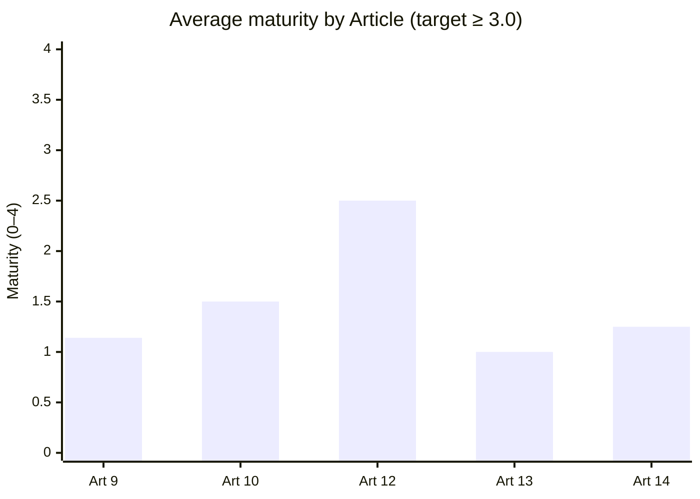

# Gap Assessment — Articles 9 to 14
**Lumina Mobility B.V.** · Document ID: LM-AIA-003 · Version 1.0 · Date: 2026-09-30 · Classification: Confidential
**Systems assessed:** S1 Dispatch Optimisation Engine · S2 Driver Performance Score (high-risk, Annex III 4(b))
**Lumina role:** Provider (primary lens) — deployer obligations noted where Lumina Ride is affected

> Structured as one row per requirement for direct export to CSV/XLSX.

---

## 1. Scoring Model

| Maturity | Label | Meaning |
|---|---|---|
| 0 | None | No evidence of the practice |
| 1 | Initial | Ad hoc, undocumented, person-dependent |
| 2 | Developing | Partially documented or partially implemented; not consistent across S1/S2 |
| 3 | Defined | Documented, implemented, owned — meets the requirement |
| 4 | Managed | Defined + measured, monitored and improved |

**Target for compliance: ≥ 3 on every requirement.** Priority: **P1** = blocks conformity / high fundamental-rights exposure · **P2** = required, moderate effort · **P3** = refinement.

## 2. Requirement-Level Assessment

| Ref | Article | Requirement (summarised) | Current state (evidence) | Score | Gap | Priority | Effort (pd) | NIST AI RMF ref |
|---|---|---|---|---|---|---|---|---|
| G-01 | 9(1)–(2) | Risk management system established, documented, maintained as continuous iterative process across lifecycle | Product risk log exists in Jira; no AI-specific RMS; not lifecycle-linked | 2 | No documented RMS procedure; no lifecycle trigger points | P1 | 40 | GV-1.3, MP-1 |
| G-02 | 9(2)(a) | Identify & analyse known and reasonably foreseeable risks to health, safety, **fundamental rights** | Technical risks considered; fundamental-rights risks (non-discrimination, fair working conditions, data protection) not analysed | 1 | No fundamental-rights risk analysis | **P1** | 60 | MP-5.1 |
| G-03 | 9(2)(b) | Estimate & evaluate risks under intended use **and reasonably foreseeable misuse** | Misuse not considered (e.g., customers using S2 for automatic deactivation) | 1 | Misuse scenarios absent | **P1** | 30 | MP-1.1 |
| G-04 | 9(2)(c) | Evaluate risks emerging from post-market monitoring data | Driver complaints tracked in support tool; not fed back to risk analysis | 1 | No PMM-to-risk loop | P2 | 40 | MG-4.1 |
| G-05 | 9(2)(d), 9(3)–(4) | Adopt appropriate, targeted risk-management measures | Some mitigations exist (rating outlier removal) but not linked to risks | 2 | Measures not traceable to risks | P2 | 30 | MG-1.3 |
| G-06 | 9(5) | Residual risk judged acceptable; residual risks communicated to deployers | No acceptance process; nothing communicated to fleet customers | 1 | No residual-risk acceptance or deployer communication | **P1** | 25 | MG-1.4 |
| G-07 | 9(6)–(8), 9(9) | Testing against prior-defined metrics & probabilistic thresholds; consider impact on vulnerable groups | Offline accuracy metrics only; no pre-defined thresholds; no subgroup analysis | 0 | No test protocol with pre-defined metrics | **P1** | 55 | MS-1.1, MS-2.11 |
| G-08 | 10(2)(a)–(e) | Data-governance practices: design choices, collection processes, origin, purpose of personal data, preparation (labelling, cleaning), assumptions | Pipelines documented in code; data catalogue covers 60% of sources; assumptions undocumented | 2 | Data sheets & assumption register missing | P2 | 60 | MP-2.3 |
| G-09 | 10(2)(f)–(g) | **Examination for possible biases** likely to affect health/safety, fundamental rights or lead to prohibited discrimination; measures to detect, prevent, mitigate | Rider ratings used as input; known literature on rating bias; no bias examination performed | 1 | No bias examination of ratings, cancellations or acceptance features | **P1** | 120 | MS-2.11, MP-2.3 |
| G-10 | 10(2)(h) | Identify relevant data gaps or shortcomings and how addressed | New-driver cold-start handled with defaults; not documented as data gap | 2 | Documentation | P3 | 15 | MP-2.3 |
| G-11 | 10(3) | Training/validation/test data relevant, sufficiently representative, as error-free and complete as possible | Data drawn from all markets but imbalanced (Amsterdam = 54%); label quality unchecked | 2 | Representativeness & quality assessment absent | P2 | 50 | MS-2.1 |
| G-12 | 10(4) | Data reflects specific geographical, contextual, behavioural, functional setting | Single global model for 11 markets | 1 | No per-market performance validation | P2 | 45 | MP-2.1 |
| G-13 | 10(5) | Conditions for processing special-category data for bias detection (strictly necessary, safeguards, deletion) | Not considered; no legal basis analysis | 1 | Decide whether special-category processing is needed; DPIA | P2 | 30 | GV-1.1 |
| G-14 | 12(1) | Automatic recording of events (logs) over system lifetime | Assignment decisions & scores logged in data warehouse | 3 | Minor: model version not consistently stamped | P3 | 10 | MS-2.8 |
| G-15 | 12(2) | Logs enable identification of risk situations / substantial modification, post-market monitoring, and deployer monitoring (Art. 26(5)) | Logs lack feature values and explanation for each S2 score change; customers cannot access | 2 | Enrich logs; deployer log access | **P1** | 80 | MS-2.8 |
| G-16 | 19 / 26(6) | Retention of logs ≥ 6 months (provider, where under its control; deployer) | 24-month retention in warehouse | 3 | Align with GDPR minimisation & document | P3 | 5 | — |
| G-17 | 12 (implied) / 15(5) | Integrity & security of logs (tamper evidence) | Logs mutable by data-engineering role | 2 | Write-once storage; access segregation | P2 | 25 | MS-2.7 |
| G-18 | 13(1) | Operation sufficiently transparent for deployers to interpret output and use appropriately | Score shown as a number and tier with no explanation | 1 | No explanation of drivers of score/assignment | **P1** | 70 | MS-2.9 |
| G-19 | 13(2)–(3)(a) | **Instructions for use**: provider identity, characteristics, capabilities, limitations, intended purpose | Admin help-centre articles only; no formal instructions for use | 1 | Author instructions for use per Art. 13(3) | **P1** | 40 | GV-4.2 |
| G-20 | 13(3)(b) | Accuracy levels & metrics, known/foreseeable circumstances affecting performance, performance on specific persons/groups | Not published to customers | 1 | Performance statement incl. subgroup performance | **P1** | 25 | MS-2.3 |
| G-21 | 13(3)(d) | Human-oversight measures incl. technical measures to facilitate interpretation | Not described | 1 | Document oversight measures (depends on G-23–G-30) | P2 | 15 | MG-2.2 |
| G-22 | 13(3)(e)–(f) | Computational resources, expected lifetime, maintenance; mechanisms to collect/store/interpret logs | Partly in SLA | 1 | Complete technical sections | P3 | 10 | — |
| G-23 | 14(1)–(2) | Designed with appropriate HMI tools so natural persons can effectively oversee during use | Ops dashboard shows aggregate KPIs only; no per-decision view | 2 | Per-driver oversight view | **P1** | 90 | MG-2.2 |
| G-24 | 14(3) | Oversight measures built into system and/or identified for deployer implementation, commensurate with risk & autonomy | S2 auto-assigns tier and auto-notifies driver; deactivation in Lumina Ride requires ops approval, but fleet customers can auto-deactivate | 1 | Remove auto-deactivation; define deployer-implemented measures | **P1** | 60 | MG-2.4 |
| G-25 | 14(4)(a) | Oversight persons can understand capacities & limitations and monitor operation, detect anomalies & unexpected performance | No training; no anomaly alerts | 1 | Training + anomaly alerting | P2 | 45 | MS-2.4 |
| G-26 | 14(4)(b) | Awareness of **automation bias** | Not addressed | 0 | Training content, UI friction for adverse decisions | P2 | 20 | MG-2.2 |
| G-27 | 14(4)(c) | Correctly interpret output, given interpretation tools | Depends on G-18 | 1 | Explanation tooling | P2 | (in G-18) | MS-2.9 |
| G-28 | 14(4)(d) | Decide not to use, disregard, override or reverse output | Ops can override tier manually in Lumina Ride; not available to customers; no reason capture | 2 | Override for deployers + reason codes | P2 | 35 | MG-2.4 |
| G-29 | 14(4)(e) | Intervene or interrupt via "stop" button or similar procedure to safe state | S1 can fall back to nearest-driver dispatch (feature flag); not exposed to customers or documented | 2 | Productise fallback; document safe state | P2 | 30 | MG-2.4 |
| G-30 | 14 + 26(2) | Oversight assigned to persons with competence, training, authority (deployer side — Lumina Ride) | Ops team of 12; no defined authority or training records | 1 | Role definition, training, authority matrix | P2 | 20 | GV-2.2 |

## 3. Results by Article

| Article | Requirements | Avg maturity | Lowest-scoring gaps | Readiness |
|---|---|---|---|---|
| Art. 9 Risk management | 7 | **1.14** | G-07 testing protocol (0) | 🔴 Initial |
| Art. 10 Data governance | 6 | **1.50** | G-09 bias examination (1), G-12 market representativeness (1) | 🟠 Initial–Developing |
| Art. 12 Record-keeping | 4 | **2.50** | G-15 log content & access (2) | 🟡 Developing |
| Art. 13 Transparency | 5 | **1.00** | G-19 no instructions for use (1) | 🔴 Initial |
| Art. 14 Human oversight | 8 | **1.25** | G-26 automation bias (0), G-24 auto-deactivation (1) | 🔴 Initial |
| **Overall** | **30** | **1.40** | | 🔴 **Initial** |

## 4. Priority Distribution & Effort

| Priority | Count | Effort (pd) |
|---|---|---|
| **P1** | 12 | 695 |
| P2 | 14 | 445 |
| P3 | 4 | 40 |
| **Total (Arts. 9–14 only)** | **30** | **1,180** |

*Effort covers analysis, design and documentation for Arts. 9–14. Engineering build, Art. 11/15/17, conformity assessment and programme overhead are estimated in the [Remediation Roadmap](Remediation-Roadmap.md).*

## 5. Cross-Cutting Observations

1. **The most serious exposure is fundamental rights, not technical failure.** S2 uses rider ratings — a known channel for customer bias — and S1 then allocates fewer high-value trips to lower-tier drivers. This compounding effect is untested (G-02, G-09).
2. **Fleet customers can configure S2 into an automated deactivation engine** (G-24). This is both the largest compliance gap and an Art. 25 role risk.
3. **Logging is the strongest area** — a foundation for Art. 12 and post-market monitoring.
4. **Platform Work Directive overlap:** PWD requirements on information about automated monitoring and decision-making systems, human review of significant decisions and worker consultation overlap with G-18, G-24 and G-28 — design once for both.
