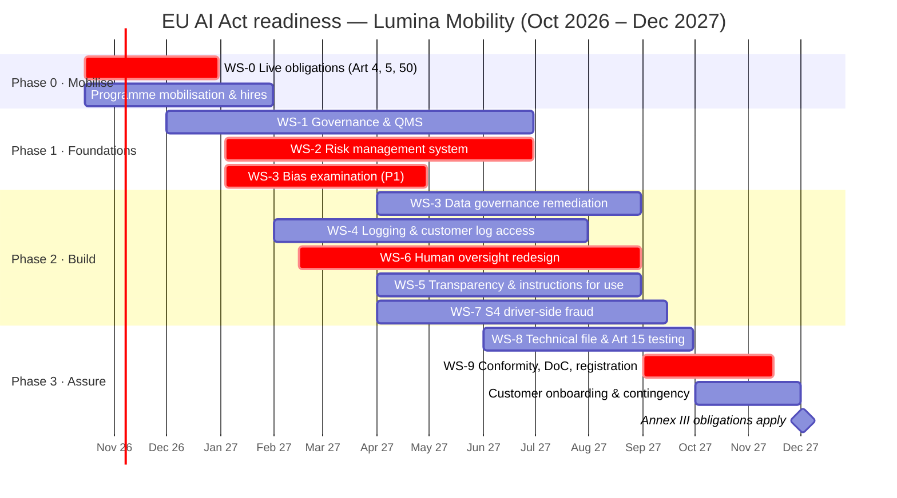

# Remediation Roadmap
**Lumina Mobility B.V.** · Document ID: LM-AIA-004 · Version 1.0 · Date: 2026-10-06 · Classification: Confidential
**Planning deadline:** 2 December 2027 (Annex III high-risk obligations, per Reg. (EU) 2026/1744) · **Internal target:** build complete Q3 2027; conformity assessment complete November 2027

---

## 1. Planning Principles
1. **Already-applicable obligations first** — Art. 4, Art. 5 and Art. 50 are live today.
2. **Fundamental-rights exposure before paperwork** — bias examination and removal of auto-deactivation (P1) precede documentation polish.
3. **Design once for AI Act + Platform Work Directive + GDPR** — overlapping transparency, human-review and logging obligations are delivered by shared workstreams.
4. **Buffer before the deadline** — 2 months' contingency for conformity assessment, customer onboarding to new instructions for use, and EU database registration.
5. **Provider obligations are a product feature** — customers (deployers) need oversight tools and log access from Lumina to meet *their* Art. 26 duties.

## 2. Workstreams & Effort

| WS | Workstream | Closes gaps | Key outputs | Owner | Effort (person-days) |
|---|---|---|---|---|---|
| WS-0 | Already-applicable obligations | AF-1 – AF-4 | AI literacy programme (Art. 4); prohibited-practice review gate (Art. 5); Art. 50 disclosures | Head of Legal & Compliance | 120 |
| WS-1 | AI governance & Quality Management System (Art. 17) | Enabler | AI policy, roles, AI governance committee; QMS procedures built on ISO/IEC 42001 structure; change management incl. substantial-modification criteria | Chief Product & Technology Officer | 380 |
| WS-2 | Risk management system (Art. 9) | G-01 – G-07 | RMS procedure; fundamental-rights risk analysis; misuse scenarios; test protocol with pre-defined metrics; residual-risk acceptance | Head of AI Governance (new hire) | 340 |
| WS-3 | Data governance & bias (Art. 10) | G-08 – G-13 | Data sheets; bias examination of ratings/cancellations/acceptance; debiasing or feature removal; per-market validation; DPIA for any special-category processing | Head of Data Science | 520 |
| WS-4 | Logging & record-keeping (Arts. 12, 19) | G-14 – G-17 | Enriched decision logs (features, version, explanation); immutable storage; customer log-export API | Head of Platform Engineering | 260 |
| WS-5 | Transparency & instructions for use (Art. 13) | G-18 – G-22 | Score/assignment explanations; instructions for use; performance statement incl. subgroup results; driver-facing explanations (PWD) | Product Lead, Driver Experience | 220 |
| WS-6 | Human oversight redesign (Art. 14) | G-23 – G-30 | Per-driver oversight console; removal of auto-deactivation; override with reason codes; productised fallback ("stop") mode; automation-bias training; Lumina Ride oversight roles | Product Lead, Fleet Admin | 480 |
| WS-7 | Driver-side fraud scoring (S4) | Classification note §3.1 | Bring S4 driver-side into WS-2 to WS-6 scope | Head of Trust & Safety | 180 |
| WS-8 | Technical documentation (Art. 11, Annex IV) & accuracy, robustness, cybersecurity (Art. 15) | Dependency | Annex IV technical file for S1, S2; robustness testing; adversarial/manipulation testing (e.g., rating manipulation) | Head of AI Governance + CISO | 300 |
| WS-9 | Conformity & market obligations | Dependency | Internal-control conformity assessment (Annex VI); EU declaration of conformity; CE marking; EU database registration (Art. 49); post-market monitoring plan (Art. 72); serious-incident procedure (Art. 73) | Head of Legal & Compliance | 150 |
| | **Total** | | | | **2,950** |

**Budget estimate:** 2,950 pd × blended €650/day ≈ **€1.92m** + tooling (explainability, log storage, GRC platform) €0.10–0.35m + external legal/assurance review €0.08–0.30m → **€2.1m – €2.6m**.
**Resourcing:** 3 new hires (Head of AI Governance, ML fairness engineer, compliance analyst); remaining effort from existing product, data and platform teams (~22% of their capacity for 12 months).

## 3. Phased Timeline

## 4. Prioritised Action List — First 90 Days

| # | Action | Gap | Why first | Due |
|---|---|---|---|---|
| 1 | Launch role-based AI literacy (ops, product, data science, sales) | AF-1 | Art. 4 already applicable | 2026-12-15 |
| 2 | Formally close "driver mood detection" and add Art. 5 check to product discovery | AF-2 | Art. 5 already applicable | 2026-10-31 |
| 3 | Add AI disclosure to driver chatbot and AI-drafted messages | AF-3, AF-4 | Art. 50 already applicable | 2026-11-15 |
| 4 | **Disable fleet-customer auto-deactivation on S2**; require human decision | G-24 | Highest fundamental-rights exposure; also PWD (transposition 2 Dec 2026) | 2026-12-31 |
| 5 | Commission bias examination of rider ratings & S2→S1 compounding effect | G-02, G-09 | Results determine model redesign scope — longest-lead item | Start 2027-01-04 |
| 6 | Hire Head of AI Governance; stand up AI governance committee | WS-1 | Accountability for programme | 2027-01-31 |
| 7 | Decide intended purpose for S2 (incl. deactivation support?) | Actor-role §4.2 | Drives Art. 25 exposure and scope of all workstreams | 2026-11-30 |
| 8 | Update customer contracts: AI Act cooperation clause, instructions-for-use acceptance | WS-9 | Two renewals already demand it | Rolling |

## 5. Dependencies & Risks to the Plan

| Risk | Impact | Mitigation |
|---|---|---|
| Bias examination reveals need to remove rating features from S2 | +3–4 months to WS-3/WS-6 | Started first; design alternatives prepared in parallel |
| Harmonised standards (CEN-CENELEC JTC 21) published late or change expectations | Rework of technical file | Build to draft standards & ISO/IEC 42001; track; contingency buffer |
| Scarce fairness-engineering talent | Delay WS-3 | Early hire + external specialist retainer |
| Fleet customers resist loss of auto-deactivation | Commercial friction | Position as joint compliance with AI Act Art. 26 and PWD; provide efficient human-review queue |
| Further amendments or Commission guidelines on Art. 6 | Classification change | Quarterly regulatory watch; re-run LM-AIA-002 |

## 6. Governance of the Programme
- **Sponsor:** CEO; **Programme owner:** CPTO; **Steering:** monthly; **Board:** quarterly status (RAG on each WS).
- **Exit criteria:** every Art. 9–14 requirement at maturity ≥ 3; Annex IV technical file complete; internal conformity assessment signed; S1 and S2 registered in EU database; instructions for use issued to all fleet customers.

## 7. KPIs

| KPI | Target |
|---|---|
| Average Art. 9–14 maturity | 1.4 → **≥ 3.0** by 2027-09-30 |
| P1 gaps closed | 100% by 2027-08-31 |
| Staff in AI-relevant roles trained (Art. 4) | ≥ 95% by 2027-03-31 |
| Fleet customers with log-export & oversight console enabled | 100% by 2027-11-15 |
| Event-rate / fare-value disparity between S2 tiers explained by legitimate factors | Documented & within tolerance set by WS-2 |
